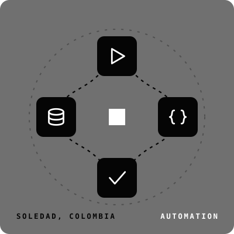
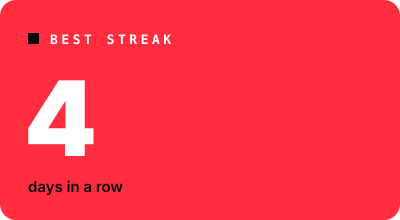
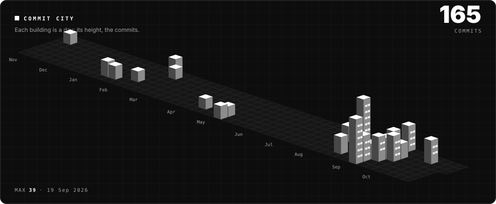
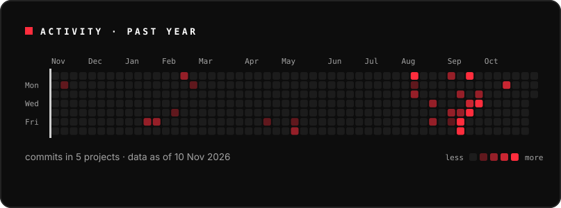
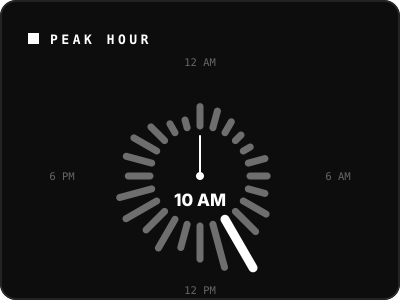
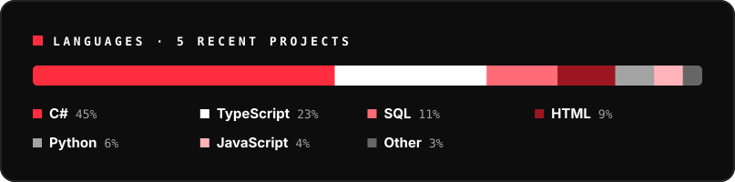
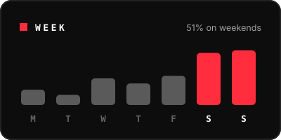

<a href="README.md"><picture><source media="(prefers-color-scheme: light)" srcset="assets/claro/en/idioma.svg"></picture></a>

<picture><source media="(prefers-color-scheme: light)" srcset="assets/claro/en/nombre.svg"></picture>
<picture><source media="(prefers-color-scheme: light)" srcset="assets/claro/en/flujo.svg"></picture>
<picture><source media="(prefers-color-scheme: light)" srcset="assets/claro/en/consola.gif"></picture>
<picture><source media="(prefers-color-scheme: light)" srcset="assets/claro/en/sobre.svg"></picture>
<picture><source media="(prefers-color-scheme: light)" srcset="assets/claro/en/cifra-commits.svg"></picture>
<picture><source media="(prefers-color-scheme: light)" srcset="assets/claro/en/cifra-dias.svg"></picture>
<picture><source media="(prefers-color-scheme: light)" srcset="assets/claro/en/cifra-racha.svg"></picture>
<picture><source media="(prefers-color-scheme: light)" srcset="assets/claro/en/hago.svg"></picture>
<picture><source media="(prefers-color-scheme: light)" srcset="assets/claro/en/stack.svg"></picture>
<picture><source media="(prefers-color-scheme: light)" srcset="assets/claro/en/ruta.svg"></picture>
<picture><source media="(prefers-color-scheme: light)" srcset="assets/claro/en/ciudad.svg"></picture>
<picture><source media="(prefers-color-scheme: light)" srcset="assets/claro/en/calor.svg"></picture>
<picture><source media="(prefers-color-scheme: light)" srcset="assets/claro/en/reloj.svg"></picture>
<picture><source media="(prefers-color-scheme: light)" srcset="assets/claro/en/lenguajes.svg"></picture>
<picture><source media="(prefers-color-scheme: light)" srcset="assets/claro/en/semana.svg"></picture>
<a href="https://github.com/LordVincenzo/LordVincenzo/raw/main/Briand_Castro_CV.pdf"><picture><source media="(prefers-color-scheme: light)" srcset="assets/claro/en/cv.svg"></picture></a>
<a href="mailto:Briandcastro11b@gmail.com"><picture><source media="(prefers-color-scheme: light)" srcset="assets/claro/en/cierre.svg"></picture></a>

