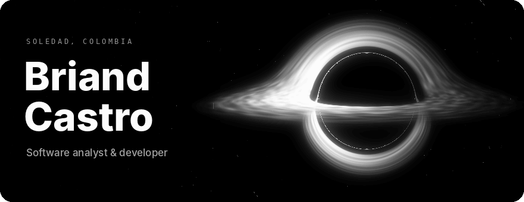

<a href="README.md"><picture><source media="(prefers-color-scheme: light)" srcset="assets/claro/en/b-idioma.svg"></picture></a>

<picture><source media="(prefers-color-scheme: light)" srcset="assets/claro/en/yo.svg"></picture>

<picture><source media="(prefers-color-scheme: light)" srcset="assets/claro/en/stack.svg"></picture>

<picture><source media="(prefers-color-scheme: light)" srcset="assets/claro/en/actividad.svg"></picture>

<picture><source media="(prefers-color-scheme: light)" srcset="assets/claro/en/ruta.svg"></picture>

<picture><source media="(prefers-color-scheme: light)" srcset="assets/claro/en/cierre.svg"></picture>

<a href="https://github.com/LordVincenzo/LordVincenzo/raw/main/Briand_Castro_CV.pdf"><picture><source media="(prefers-color-scheme: light)" srcset="assets/claro/en/b-cv.svg"></picture></a>&nbsp;&nbsp;&nbsp;<a href="mailto:Briandcastro11b@gmail.com"><picture><source media="(prefers-color-scheme: light)" srcset="assets/claro/en/b-mail.svg"></picture></a>

