 

I automate the repetitive with <b>n8n</b> and build web and mobile apps end to end. Technologist in Software Analysis and Development. Today I manage the <b>Prizma</b> learning platform at Corporación Universitaria Americana, where I automated course loading.

<a href="mailto:Briandcastro11b@gmail.com"><picture><source media="(prefers-color-scheme: light)" srcset="assets/botones/claro/en/escribeme.svg"></picture></a>&nbsp;
<a href="https://github.com/LordVincenzo/LordVincenzo/raw/main/Briand_Castro_CV.pdf"><picture><source media="(prefers-color-scheme: light)" srcset="assets/botones/claro/en/cv.svg"></picture></a>&nbsp;
<a href="README.md"><picture><source media="(prefers-color-scheme: light)" srcset="assets/botones/claro/en/idioma.svg"></picture></a>

 

