
<a href="README.en.md"><picture><source media="(prefers-color-scheme: light)" srcset="assets/claro/es/idioma.svg"></picture></a>

<picture><source media="(prefers-color-scheme: light)" srcset="assets/claro/es/nombre.svg"></picture>
<picture><source media="(prefers-color-scheme: light)" srcset="assets/claro/es/robot.svg"></picture>
<picture><source media="(prefers-color-scheme: light)" srcset="assets/claro/es/consola.gif">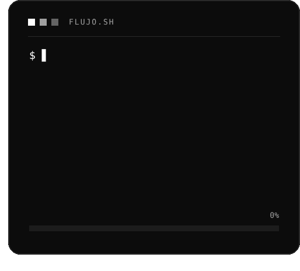</picture>
<picture><source media="(prefers-color-scheme: light)" srcset="assets/claro/es/sobre.svg">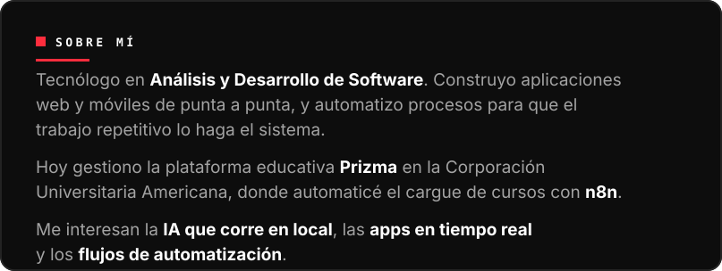</picture>
<picture><source media="(prefers-color-scheme: light)" srcset="assets/claro/es/cifra-commits.svg"></picture>
<picture><source media="(prefers-color-scheme: light)" srcset="assets/claro/es/cifra-dias.svg">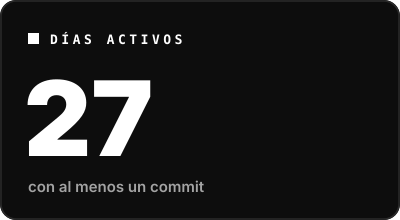</picture>
<picture><source media="(prefers-color-scheme: light)" srcset="assets/claro/es/cifra-racha.svg">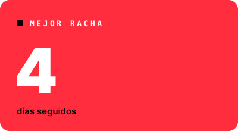</picture>
<picture><source media="(prefers-color-scheme: light)" srcset="assets/claro/es/hago.svg">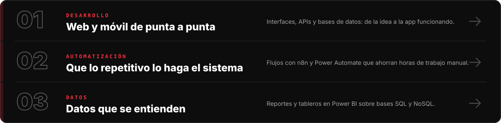</picture>
<picture><source media="(prefers-color-scheme: light)" srcset="assets/claro/es/stack.svg"></picture>
<picture><source media="(prefers-color-scheme: light)" srcset="assets/claro/es/ruta.svg"></picture>
<picture><source media="(prefers-color-scheme: light)" srcset="assets/claro/es/ciudad.svg">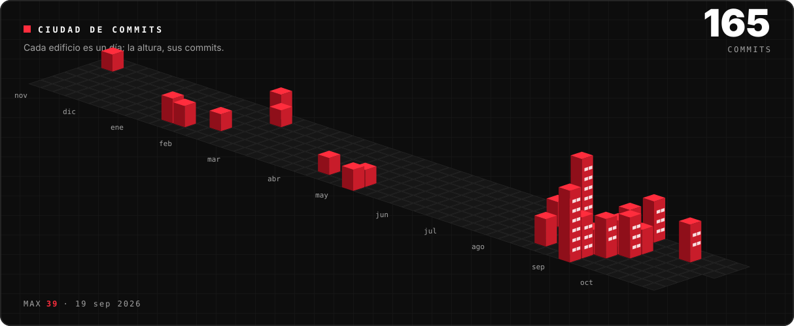</picture>
<picture><source media="(prefers-color-scheme: light)" srcset="assets/claro/es/calor.svg"></picture>
<picture><source media="(prefers-color-scheme: light)" srcset="assets/claro/es/reloj.svg">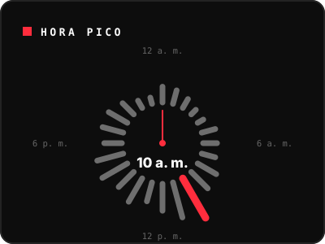</picture>
<picture><source media="(prefers-color-scheme: light)" srcset="assets/claro/es/lenguajes.svg">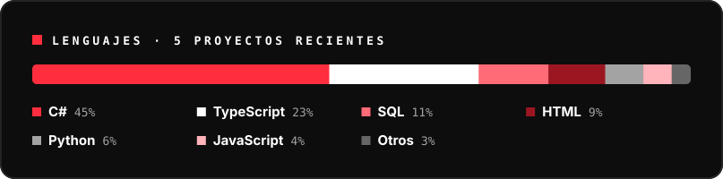</picture>
<picture><source media="(prefers-color-scheme: light)" srcset="assets/claro/es/semana.svg">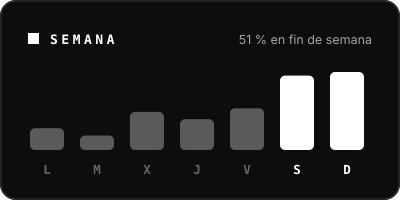</picture>
<a href="https://github.com/LordVincenzo/LordVincenzo/raw/main/Briand_Castro_CV.pdf"><picture><source media="(prefers-color-scheme: light)" srcset="assets/claro/es/cv.svg">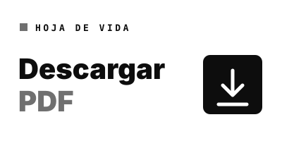</picture></a>
<a href="mailto:Briandcastro11b@gmail.com"><picture><source media="(prefers-color-scheme: light)" srcset="assets/claro/es/cierre.svg"></picture></a>

