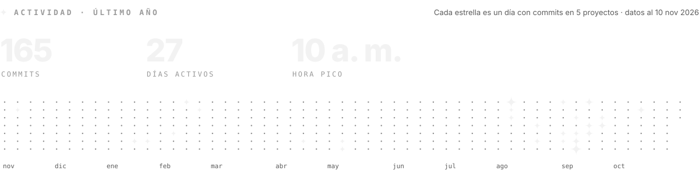

 

Automatizo lo repetitivo con <b>n8n</b> y construyo apps web y móviles de punta a punta. Tecnólogo en Análisis y Desarrollo de Software. Hoy gestiono la plataforma educativa <b>Prizma</b> en la Corporación Universitaria Americana, donde automaticé el cargue de cursos.

<a href="mailto:Briandcastro11b@gmail.com"><picture><source media="(prefers-color-scheme: light)" srcset="assets/claro/es/btn-escribeme.svg"></picture></a>&nbsp;
<a href="https://github.com/LordVincenzo/LordVincenzo/raw/main/Briand_Castro_CV.pdf"><picture><source media="(prefers-color-scheme: light)" srcset="assets/claro/es/btn-cv.svg"></picture></a>&nbsp;
<a href="README.en.md"><picture><source media="(prefers-color-scheme: light)" srcset="assets/claro/es/btn-idioma.svg"></picture></a>

 

<picture><source media="(prefers-color-scheme: light)" srcset="assets/claro/es/hago.svg"></picture>

 

 

<picture><source media="(prefers-color-scheme: light)" srcset="assets/claro/es/ruta.svg"></picture>

 

<picture><source media="(prefers-color-scheme: light)" srcset="assets/claro/es/actividad.svg"></picture>
