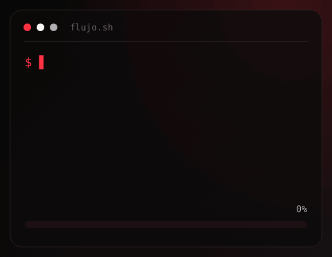
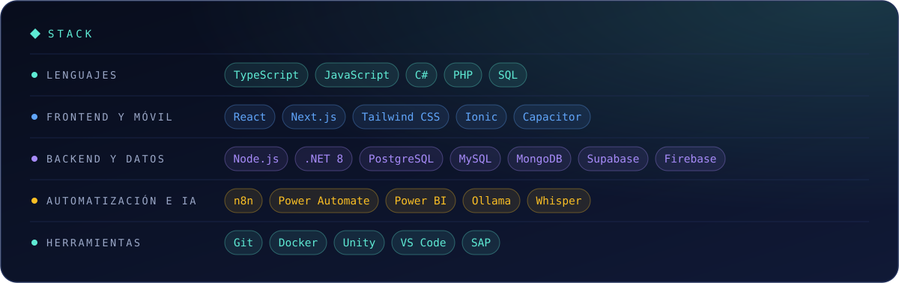

<table>
<tr>
<td width="36%" align="center">

</td>
<td width="64%" valign="middle">

Soy tecnólogo en **Análisis y Desarrollo de Software**. Construyo aplicaciones web y móviles de punta a punta, y automatizo procesos para que el trabajo repetitivo lo haga el sistema.

Hoy gestiono la plataforma educativa **Prizma** en la Corporación Universitaria Americana, donde automaticé el cargue de cursos con **n8n**. Antes trabajé en **Procaps** con Power BI, Power Automate y SAP.

Me interesan la **IA que corre en local**, las **apps en tiempo real** y los **flujos de automatización**.

&nbsp;

</td>
</tr>
</table>

Gracias por pasar · <a href="mailto:Briandcastro11b@gmail.com">hablemos</a>

