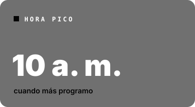

<a href="README.en.md"><picture><source media="(prefers-color-scheme: light)" srcset="assets/claro/es/idioma.svg"></picture></a>

<picture><source media="(prefers-color-scheme: light)" srcset="assets/claro/es/sobre.svg"></picture>
<picture><source media="(prefers-color-scheme: light)" srcset="assets/claro/es/consola.gif"></picture>
<picture><source media="(prefers-color-scheme: light)" srcset="assets/claro/es/hago.svg"></picture>

<picture><source media="(prefers-color-scheme: light)" srcset="assets/claro/es/stack-titulo.svg"></picture>

<picture><source media="(prefers-color-scheme: light)" srcset="https://cdn.simpleicons.org/typescript/0d0d0d"></picture>&nbsp;&nbsp;&nbsp;&nbsp;
<picture><source media="(prefers-color-scheme: light)" srcset="https://cdn.simpleicons.org/javascript/0d0d0d"></picture>&nbsp;&nbsp;&nbsp;&nbsp;
<picture><source media="(prefers-color-scheme: light)" srcset="https://cdn.simpleicons.org/php/0d0d0d"></picture>&nbsp;&nbsp;&nbsp;&nbsp;
<picture><source media="(prefers-color-scheme: light)" srcset="https://cdn.simpleicons.org/react/0d0d0d"></picture>&nbsp;&nbsp;&nbsp;&nbsp;
<picture><source media="(prefers-color-scheme: light)" srcset="https://cdn.simpleicons.org/nextdotjs/0d0d0d"></picture>&nbsp;&nbsp;&nbsp;&nbsp;
<picture><source media="(prefers-color-scheme: light)" srcset="https://cdn.simpleicons.org/tailwindcss/0d0d0d"></picture>&nbsp;&nbsp;&nbsp;&nbsp;
<picture><source media="(prefers-color-scheme: light)" srcset="https://cdn.simpleicons.org/ionic/0d0d0d"></picture>&nbsp;&nbsp;&nbsp;&nbsp;
<picture><source media="(prefers-color-scheme: light)" srcset="https://cdn.simpleicons.org/capacitor/0d0d0d"></picture>&nbsp;&nbsp;&nbsp;&nbsp;
<picture><source media="(prefers-color-scheme: light)" srcset="https://cdn.simpleicons.org/nodedotjs/0d0d0d"></picture>&nbsp;&nbsp;&nbsp;&nbsp;
<picture><source media="(prefers-color-scheme: light)" srcset="https://cdn.simpleicons.org/dotnet/0d0d0d"></picture>
  
<picture><source media="(prefers-color-scheme: light)" srcset="https://cdn.simpleicons.org/postgresql/0d0d0d"></picture>&nbsp;&nbsp;&nbsp;&nbsp;
<picture><source media="(prefers-color-scheme: light)" srcset="https://cdn.simpleicons.org/mysql/0d0d0d"></picture>&nbsp;&nbsp;&nbsp;&nbsp;
<picture><source media="(prefers-color-scheme: light)" srcset="https://cdn.simpleicons.org/mongodb/0d0d0d"></picture>&nbsp;&nbsp;&nbsp;&nbsp;
<picture><source media="(prefers-color-scheme: light)" srcset="https://cdn.simpleicons.org/supabase/0d0d0d"></picture>&nbsp;&nbsp;&nbsp;&nbsp;
<picture><source media="(prefers-color-scheme: light)" srcset="https://cdn.simpleicons.org/firebase/0d0d0d"></picture>&nbsp;&nbsp;&nbsp;&nbsp;
<picture><source media="(prefers-color-scheme: light)" srcset="https://cdn.simpleicons.org/n8n/0d0d0d"></picture>&nbsp;&nbsp;&nbsp;&nbsp;
<picture><source media="(prefers-color-scheme: light)" srcset="https://cdn.simpleicons.org/ollama/0d0d0d"></picture>&nbsp;&nbsp;&nbsp;&nbsp;
<picture><source media="(prefers-color-scheme: light)" srcset="https://cdn.simpleicons.org/docker/0d0d0d"></picture>&nbsp;&nbsp;&nbsp;&nbsp;
<picture><source media="(prefers-color-scheme: light)" srcset="https://cdn.simpleicons.org/git/0d0d0d"></picture>&nbsp;&nbsp;&nbsp;&nbsp;
<picture><source media="(prefers-color-scheme: light)" srcset="https://cdn.simpleicons.org/unity/0d0d0d"></picture>
  
C# &nbsp;·&nbsp; Power BI &nbsp;·&nbsp; Power Automate &nbsp;·&nbsp; SAP &nbsp;·&nbsp; VS Code

<picture><source media="(prefers-color-scheme: light)" srcset="assets/claro/es/galaxia.svg"></picture>
<picture><source media="(prefers-color-scheme: light)" srcset="assets/claro/es/ruta.svg"></picture>
<picture><source media="(prefers-color-scheme: light)" srcset="assets/claro/es/cifra-commits.svg"></picture>
<picture><source media="(prefers-color-scheme: light)" srcset="assets/claro/es/cifra-dias.svg"></picture>
<picture><source media="(prefers-color-scheme: light)" srcset="assets/claro/es/cifra-hora.svg"></picture>
<a href="https://github.com/LordVincenzo/LordVincenzo/raw/main/Briand_Castro_CV.pdf"><picture><source media="(prefers-color-scheme: light)" srcset="assets/claro/es/cv.svg"></picture></a>
<a href="mailto:Briandcastro11b@gmail.com"><picture><source media="(prefers-color-scheme: light)" srcset="assets/claro/es/cierre.svg"></picture></a>

